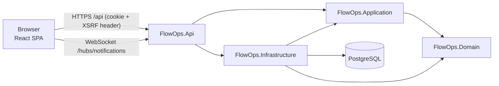
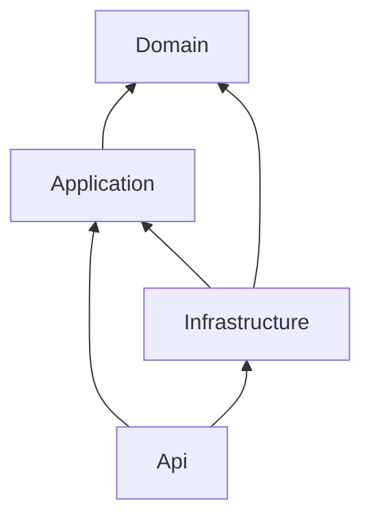
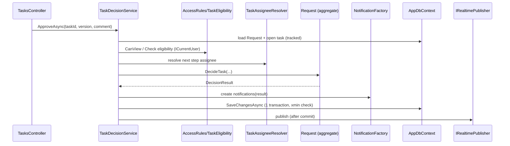

# Architecture — FlowOps Phase 1

**Purpose:** system structure, module boundaries, dependency rules, and exactly what belongs in each layer.
Read this before writing any code. Rules derived from it are in `.claude/rules/architecture.md`; detailed coding guidance is in `CODE_STANDARDS.md`.

---

## 1. System overview

A **modular monolith**: one deployable ASP.NET Core API, one React SPA, one PostgreSQL database (ADR-0001).



Same origin everywhere: Vite proxies `/api` and `/hubs` in development; a reverse proxy serves both in deployment (`docker compose up`: nginx terminates TLS and proxies `/api` and `/hubs`, OPS-01). No CORS.

---

## 2. Repository layout

```
flowops/
├── AGENTS.md / CLAUDE.md        agent entry points
├── .claude/                     rules, agents, skills
├── docs/                        this documentation (+ decisions/)
├── contracts/openapi.json       generated by the API; committed; frontend generates types from it
├── src/backend/
│   ├── FlowOps.Domain/          entities, value objects, process definitions, domain errors
│   ├── FlowOps.Application/     use-case services, DTOs, access rules, ports (interfaces)
│   ├── FlowOps.Infrastructure/  EF Core DbContext, migrations, Identity stores, SignalR publisher
│   └── FlowOps.Api/             controllers, auth config, middleware, hub, Program.cs
├── tests/backend/
│   ├── FlowOps.Domain.Tests/          fast unit tests (no I/O)
│   └── FlowOps.Api.IntegrationTests/  Testcontainers PostgreSQL + WebApplicationFactory
├── src/frontend/                React + Vite app (tests colocated)
├── docker-compose.yml           PostgreSQL for local development
└── scripts/                     small dev helpers
```

Why two test projects instead of one `FlowOps.Tests`: domain tests run in milliseconds with no Docker; integration tests need Docker. Splitting them lets agents run the fast suite on every change.

Application tests (service-level) are **integration tests through the API** in Phase 1 — mocking `DbContext` produces tests that pass while the SQL is wrong. Pure logic inside Application (e.g. `ManagerAssignmentRules`) can be unit-tested in the domain test project's sibling folder if it grows; don't create a third project preemptively.

---

## 3. Dependency rules (enforced)



| Project | May reference | Must not reference |
|---|---|---|
| Domain | BCL only | EF Core, ASP.NET, Identity, any NuGet beyond BCL |
| Application | Domain, `Microsoft.EntityFrameworkCore` (abstractions for `DbSet`/LINQ), `Microsoft.Extensions.*` abstractions | Npgsql, ASP.NET Core, SignalR, Infrastructure |
| Infrastructure | Application, Domain, Npgsql, Identity EF stores, SignalR | Api |
| Api | Application, Infrastructure (composition root only) | — |

`Api → Infrastructure` exists **only** for DI registration (`services.AddInfrastructure(config)`) and migrations. Controllers never use Infrastructure types.

An architecture test (`NetArchTest.eNhancedEdition` or a hand-written reflection test) in `FlowOps.Api.IntegrationTests/Architecture/` asserts the table above.

**Application depends on EF Core abstractions** (not Npgsql) on purpose: it lets query services use LINQ projections directly against `IAppDbContext` instead of hiding EF behind generic repositories that add nothing (ADR-0007).

---

## 4. Layer responsibilities

### 4.1 Api (HTTP adapter)

**Contains:** controllers, route/attribute config, authentication & authorization *policy* setup, exception→ProblemDetails mapping, must-change-password middleware, `ICurrentUser` implementation, SignalR hub endpoint, OpenAPI config.

**A controller action does exactly:** bind → (attribute) authorize → call **one** service method → map result to HTTP. Target ≤ 10 lines per action; no `try/catch`; no `DbContext`; no `if` on business state.

```csharp
[HttpPost("{taskId:guid}/approve")]
[ProducesResponseType(StatusCodes.Status204NoContent)]
[ProducesResponseType<ProblemDetails>(StatusCodes.Status409Conflict)]
public async Task<IActionResult> Approve(Guid taskId, ApproveTaskRequest body, CancellationToken ct)
{
    await taskDecisions.ApproveAsync(taskId, body.Version, body.Comment, ct);
    return NoContent();
}
```
The actor is resolved inside the service from `ICurrentUser`. Validation of `body` shape happens automatically via `[ApiController]` + DataAnnotations. Errors propagate as exceptions to the global handler.

### 4.2 Application (use cases)

Organised **by feature folder**, each with its services, DTOs and validators:

```
FlowOps.Application/
├── Common/        ICurrentUser, IAppDbContext, IRealtimePublisher, AppException types,
│                  PagedResult<T>, PageRequest, Paging extensions
├── Access/        AccessRules, TaskEligibility
├── Requests/      RequestSubmissionService, RequestQueryService, RequestCommentService,
│                  TaskAssigneeResolver, RequestNumberGenerator (port), DTOs
├── Tasks/         TaskDecisionService, TaskQueryService, DTOs
├── Notifications/ NotificationFactory, NotificationService (read/mark), DTOs
├── Organization/  AuthService, CapabilityRules, ManagerRelationship, DepartmentService,
│                  UserAdministrationService, ManagerAssignmentRules,
│                  IIdentitySignIn + IIdentityAdmin (ports), DTOs
├── Dashboard/     DashboardQueryService, DTOs
└── DependencyInjection.cs
```

**Service rules**
- A service = a cohesive set of use cases on one feature. Split command services from query services when both grow (already split for Requests/Tasks).
- Services call the domain for decisions, `IAppDbContext` for persistence, shared helpers for cross-cutting knowledge. **Services do not call other use-case services** (prevents cycles and hidden transactions). Shared knowledge lives in helpers (`AccessRules`, `TaskAssigneeResolver`, `NotificationFactory`) that never call `SaveChangesAsync`.
- **Only use-case services call `SaveChangesAsync`, exactly once per use case.** That makes transaction ownership obvious.
- Return DTOs, never entities.
- No MediatR, no AutoMapper (both are now commercially licensed and add indirection this size of app doesn't need). Mapping is explicit: `static Dto From(Entity e)` or LINQ `Select` projections.

### 4.3 Domain (business rules)

**Contains:** `Request` aggregate (+ `WorkTask`, `RequestActivity`, details), `Money`, enums, `FixedProcesses`, `ProcessStep`, `DomainException` with stable `Code`s.

- State changes only through aggregate methods; setters private.
- No I/O, no async, no DI, no `DateTime.Now` (time passed in).
- Throws `DomainException(code, message)` for rule violations; the Api maps codes to HTTP status (see `API_CONTRACT.md` §2).

### 4.4 Infrastructure (technical adapters)

`AppDbContext : IdentityDbContext<ApplicationUser, IdentityRole<Guid>, Guid>, IAppDbContext`, entity configurations (`IEntityTypeConfiguration<T>` one per aggregate), migrations, `RequestNumberGenerator` (PostgreSQL sequence), `IdentityAdmin` (wraps `UserManager`/`RoleManager`), `IdentitySignIn` (wraps `SignInManager`), `SignalRRealtimePublisher`, bootstrap-admin seeding, the Development-only demo seeder (`--seed-demo`, BE-16).

Where does `ApplicationUser` live? In **Domain** (`FlowOps.Domain.Organization`) as a plain class *without* Identity base types would require duplication; pragmatic decision: `ApplicationUser : IdentityUser<Guid>` lives in **Infrastructure**, and Application/Domain refer to users through `Guid` ids and small read models (`UserRef`). `IAppDbContext` exposes `IQueryable<UserReadModel> Users` and `IQueryable<UserRoleReadModel> UserRoles` (LINQ projections over the Identity tables, composable and translated to SQL) for queries. See ADR-0002.

---

## 5. Process orchestration



**Extending with a new request type (Open/Closed in practice):** add a `RequestType` value, a details class + EF config, an entry in `FixedProcesses`, a submit method on `RequestSubmissionService` + endpoint, and a frontend form. `TaskDecisionService`, `AccessRules`, inbox, notifications and activity need **no changes**. If adding a type forces edits to those, the design has leaked — flag it.

---

## 6. Cross-cutting concerns

| Concern | Mechanism | Single location |
|---|---|---|
| Errors | Exceptions (`DomainException`, `NotFoundException`, `ForbiddenException`, `ConflictException`) → `IExceptionHandler` → ProblemDetails | `Api/Errors/ProblemDetailsExceptionHandler.cs` |
| Input validation | DataAnnotations on request DTOs + `[ApiController]` automatic 400 | DTO classes |
| Business validation | Domain methods / Application rule helpers | Domain, Application |
| Current user | `ICurrentUser` | `Api/Auth/HttpCurrentUser.cs` |
| Time | `TimeProvider` (BCL) injected | DI |
| Paging | `PageRequest` + `IQueryable.ToPagedResultAsync()` | `Application/Common/Paging.cs` |
| Logging | `ILogger<T>` + JSON console formatter; request logging middleware with trace ids | Program.cs |
| Real-time | `IRealtimePublisher` port | Infrastructure |

No Serilog in Phase 1: the built-in JSON console logger gives structured logs; add Serilog only with a concrete sink requirement.

---

## 7. Frontend architecture (summary)

Full spec in `UI_SPEC.md`; rules in `.claude/rules/frontend.md`.

```
src/frontend/src/
├── app/              App.tsx, providers.tsx, router.tsx, route guards (pages other than the dashboard are lazy route chunks, #101)
├── components/ui/    design-system primitives (Button, StatusBadge, Dialog, …)
├── components/layout/AppShell, Sidebar, TopBar, PageHeader
├── features/<name>/  api.ts (query keys + hooks), components/, pages/, schemas.ts
├── lib/api/          client.ts (openapi-fetch + XSRF), schema.d.ts (generated), problem.ts
├── lib/realtime/     SignalR connection → query invalidation (SignalR loaded on demand)
├── lib/connectivity/ connection lost/back (drives TanStack's onlineManager; ConnectionBanner reads it)
├── lib/format/       dates, money, status labels
└── styles/theme.css  Tailwind v4 @theme tokens — the ONLY place colours are defined
```

Data flow: page → feature hook (`useMyRequests`) → `lib/api/client` → API. Server state lives only in TanStack Query. No global client-state library (Context for session only).
