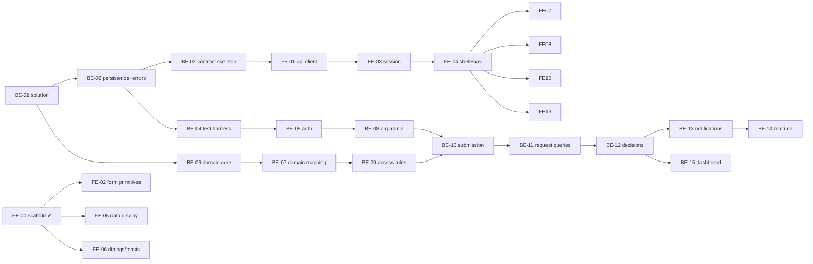

# Phase 1 Backlog — FlowOps

**Purpose:** the ordered, dependency-aware implementation backlog. Each task is sized for one focused coding session (roughly ½–1 day for a person).
**How to use:** pick the lowest-numbered task in your lane whose dependencies are **Done**; run the `implement-feature` skill with its ID; update its status line here in the same PR.

Status values: `Todo` · `In progress` · `Done` · `Blocked (reason)`.

Every task inherits the **Definition of Done** (`AGENTS.md` §8). "Tests" lists the minimum; add more when behaviour warrants.

---

## Lanes and order



**Parallel lanes once BE-03 is Done:** Backend (BE-04…BE-16) ‖ Frontend (FE-01…FE-13 against MSW mocks generated from `contracts/openapi.json`). Frontend features need only the *contract* (BE-03), not the backend implementation; integration with the real API happens when the matching BE task is Done.

**Changes vs. the original suggested order:** the API contract skeleton (BE-03) is moved right after scaffolding, so frontend work doesn't wait for backend features; the domain core (BE-06) is pure C# and starts in parallel with infrastructure; notifications are split into persistence (with decisions) and realtime (later), because notification rows must be written in the decision transaction.

---

## Foundation

### FE-00 — Frontend scaffold, theme tokens, first primitives · `Done` (architecture session)
Vite + React + TS strict, Tailwind v4 with `theme.css` tokens (default palette disabled), `Button`, `StatusBadge`, `AppShell` placeholder, Vitest + Testing Library, token lint. Verified: typecheck, lint, test, build.

### BE-01 — Backend solution scaffold · `Done`
- **Objective:** create the solution exactly as `ARCHITECTURE.md` §2–3.
- **Deps:** none. **Modules:** `src/backend/*`, `tests/backend/*`, root `FlowOps.slnx`, `global.json`, `Directory.Build.props`, `Directory.Packages.props`.
- **Steps (exact):**
  ```bash
  dotnet new sln -n FlowOps --format slnx
  dotnet new classlib -n FlowOps.Domain         -o src/backend/FlowOps.Domain
  dotnet new classlib -n FlowOps.Application    -o src/backend/FlowOps.Application
  dotnet new classlib -n FlowOps.Infrastructure -o src/backend/FlowOps.Infrastructure
  dotnet new webapi   -n FlowOps.Api --use-controllers -o src/backend/FlowOps.Api
  dotnet new install xunit.v3.templates
  dotnet new xunit3 -n FlowOps.Domain.Tests -o tests/backend/FlowOps.Domain.Tests
  dotnet new xunit3 -n FlowOps.Api.IntegrationTests -o tests/backend/FlowOps.Api.IntegrationTests
  # add all to sln; add project references per ARCHITECTURE.md §3
  ```
  Enable central package management; `Directory.Build.props`: `net10.0`, `Nullable=enable`, `ImplicitUsings=enable`, `TreatWarningsAsErrors=true`, `AnalysisLevel=latest-recommended`.
  Api: set `launchSettings.json` HTTPS URL to `https://localhost:7180` (the Vite proxy and docs assume it); remove WeatherForecast; add `GET /api/health` (anonymous, 200 `{status:"ok"}`); JSON console logging; `AddProblemDetails()`.
- **AC:** `dotnet build` with 0 warnings; `dotnet test` runs (one placeholder test per project); references match §3 exactly.
- **Tests:** architecture test asserting the dependency table (can use reflection over referenced assemblies).
- **Parallel:** with BE-06 once projects exist.

### BE-02 — Persistence foundation and error pipeline · `Done`
- **Objective:** `AppDbContext` (Identity), Npgsql, snake_case naming, migrations workflow, `IAppDbContext`, global exception→ProblemDetails handler, `ICurrentUser`, `TimeProvider`.
- **Deps:** BE-01. **Modules:** Infrastructure/Persistence, Application/Common, Api/Errors, Api/Auth.
- **AC:** `docker compose up -d db` + `dotnet ef database update` creates schema; exception types map to the statuses in `API_CONTRACT.md` §2 with `code` and `traceId`; unhandled → 500 without internals; connection string from env/user-secrets only.
- **Tests:** unit tests for the exception→status mapping table.
- **Parallel:** BE-06.

### BE-03 — API contract skeleton + OpenAPI export · `Done`
- **Objective:** make `API_CONTRACT.md` executable: every request/response DTO and every controller action with correct routes, `[ProducesResponseType]`s, and policies, each action returning `501 Not Implemented` until its feature task lands. Export `contracts/openapi.json` via build-time generation (`Microsoft.Extensions.ApiDescription.Server`) and a `scripts/export-openapi.sh` wrapper.
- **Deps:** BE-02. **Modules:** Api/Controllers, Application/*/Dtos.
- **AC:** `contracts/openapi.json` contains all endpoints in `API_CONTRACT.md` §3–8 with enums as strings and `version`/money amount as strings; script is deterministic (re-run gives identical file).
- **Tests:** a test that the generated document equals the committed file (drift check).
- **Parallel:** BE-06/BE-07.

### BE-04 — Integration test harness · `Done`
- **Objective:** everything in `TESTING.md` §2 for the backend.
- **Deps:** BE-02. **AC:** a sample test spins PostgreSQL via Testcontainers, applies migrations, hits `/api/health`; Respawn reset works between tests; suite runs in < 30 s locally after image pull.
- **Parallel:** BE-06.

### BE-05 — Identity, cookie auth, antiforgery, bootstrap admin · `Done`
- **Objective:** `AUTHORIZATION.md` §1–2 and §6 (policies, must-change-password middleware); `POST /auth/login`, `/logout`, `GET /auth/me` (with capabilities), `POST /auth/change-password`.
- **Deps:** BE-03, BE-04. **Modules:** Api/Auth, Infrastructure/Identity, Application/Organization (capabilities).
- **AC:** 401 JSON (no redirects); lockout 5/15 min; XSRF cookie issued + enforced on unsafe methods; bootstrap admin created once from config; roles seeded.
- **Tests:** login success/failure/lockout; 401 shape; XSRF missing → rejected; must-change-password gate; capabilities per role combo (incl. derived `isManager`→`tasks.view`).

### BE-06 — Domain core: Request aggregate & fixed processes · `Done`
- **Objective:** everything in `DOMAIN_MODEL.md` §2–5 as pure C# (no EF attributes).
- **Deps:** BE-01. **Modules:** FlowOps.Domain only.
- **AC:** all invariants I2–I9 enforced in the aggregate; no public setters on state; `FixedProcesses` is the only place step order exists.
- **Tests:** all of `TESTING.md` §3.1.
- **Parallel:** BE-02…BE-05 (no shared files).

### BE-07 — Domain persistence mapping · `Done`
- **Objective:** EF configurations for Request/details/WorkTask/Activity/Notification (Department and the user profile columns landed early in BE-05, which `/api/auth/me` needed); `xmin` tokens; constraints and indexes from `DOMAIN_MODEL.md` §6; request-number sequence; migration.
- **Deps:** BE-02, BE-06. **AC:** migration applies cleanly; partial unique index and check constraints exist (assert via `information_schema`/`pg_indexes` in a test).
- **Tests:** round-trip persistence of a full purchase aggregate; inserting a second open task fails at DB level.

## Organization

### BE-08 — Departments & user administration API · `Done`
- **Objective:** `API_CONTRACT.md` §8 (departments, users, roles, reset password) via `DepartmentService`, `UserAdministrationService`, `ManagerAssignmentRules`.
- **Deps:** BE-05, BE-07. **AC:** cycle/self-manager prevention (I13); last-admin protection; duplicate email/department → 409; inactive department can't receive members.
- **Tests:** each error code; non-admin → 403; paging/search.

### BE-08b — Admin self-authority (follow-up) · `Done`
- **Objective:** an admin can't change their own roles or manager link, make themselves anyone's manager (incl. by reactivating a report) or deactivate themselves → 422 `user.self_administration`; resetting another user's password stays allowed and is audit-logged with the actor id. #24, #27. Self password reset via the admin endpoint → 422 too (BE-08c, #31). #32 → ADR-0012 (accepted), implemented by BE-08d.

### BE-08d — Role-change rules (ADR-0012) · `Done`
- **Objective:** `Administrator` can't be added by `PUT /users/{id}/roles` (422 `user.admin_role_on_create_only`); an admin's own role change becomes a pending `RoleChange` (202) that another active admin approves, rejects or the proposer cancels; 72 h expiry; `RoleChangePending` notifications. ADR-0012 §1–7.
- **Deps:** BE-08. (Notifications are written with the existing `Notification` entity; users read them once BE-13 lands.) **AC:** approver checked against the database; stale and expired changes refused; one `SaveChangesAsync` per use case; contract and openapi updated.
- **Tests:** each new error code; self-approval; only-admin refusal; stale after a direct change; expiry with `FakeTimeProvider`; approve/cancel race (≥ 20 runs); notifications.

## Requests and process

### BE-09 — Access rules & task eligibility · `Done`
- **Objective:** `AccessRules.VisibleTo` and `TaskEligibility` (`AUTHORIZATION.md` §4) as the single implementation.
- **Deps:** BE-07. **AC:** translates to one SQL query (no client evaluation); used by no code yet except tests.
- **Tests:** table-driven integration tests over a seeded org for R1/R2/R3 and T1/T2 incl. self-decision and inactive users.

### BE-10 — Submit purchase & leave · `Done`
- **Objective:** `RequestSubmissionService`, `TaskAssigneeResolver`, `NotificationFactory` (TaskAssigned), endpoints `POST /requests/purchase|leave`.
- **Deps:** BE-08, BE-09. **AC:** server-side requester/department; 422s for missing manager/department; one transaction; returns `RequestDetailsDto` 201 with `Location`.
- **Tests:** `TESTING.md` §3.2 submission rows; validation limits (boundary values); company-TZ "today".
- **Follow-up BE-10b (`Done`):** leave days counted inclusively, `days = (end − start) + 1`, max `RequestLimits.LeaveMaxDays` = 90; tests at 89/90/91 days and same-day = 1 (domain and API).

### BE-11 — Request queries & comments · `Done`
- **Objective:** `GET /requests`, `/requests/{id}`, `/activity`, `POST /comments`; `availableActions` via `TaskEligibility`; leave-reason masking.
- **Deps:** BE-10. **AC:** projections only (no entity graphs to DTO in memory); filters/search/paging; 404 for invisible.
- **Tests:** `TESTING.md` §3.3 visibility rows; reason masking; comment notifications.
- **Follow-up BE-11b (`Done`, security review):** HR reads a leave reason only through the HR task (a former manager who also holds HrOfficer doesn't); `page` capped at 10,000 (was a 500 on overflow); extra negative tests. Activity returns the newest 500 entries and comments are rate-limited per user (BE-11c, #37). Open: #38 (frontend hint).

### BE-12 — Inbox & decisions (approve/reject/fulfill) · `Done`
- **Objective:** `TaskQueryService` (`GET /tasks`), `TaskDecisionService` (one pipeline, `CODE_STANDARDS.md` §2.4), concurrency mapping, decision notifications.
- **Deps:** BE-11. **AC:** `WORKFLOWS.md` §2–5 behaviour exactly.
- **Tests:** `TESTING.md` §3.2 full paths, §3.3 decision rows, §3.4 all concurrency tests.
- **Contract:** `InboxItemDto.actions` is in the contract (DTO, openapi, API_CONTRACT §5). `GET /tasks` must fill it from the same eligibility source as `availableActions.actions` (`[]` for Done items), with a test.
- **Note:** highest-risk task — request an `architecture-reviewer` and `security-reviewer` pass before merging.

### BE-13 — Notifications API · `Done`
- **Objective:** `API_CONTRACT.md` §6. **Deps:** BE-12. **Tests:** own-only access; read-all; unread count.

### BE-14 — Real-time hub & post-commit publishing · `Done`
- **Objective:** `/hubs/notifications`, user groups, `SignalRRealtimePublisher`; services publish after `SaveChangesAsync`.
- **Deps:** BE-13. **AC:** events and recipients per `API_CONTRACT.md` §9; publisher failures are logged, never fail the request.
- **Tests:** `TESTING.md` §3.5; one hub connection test with cookie auth.

### BE-14b — Hub connection cap (#55) · `Done`
- **Objective:** a signed-in user can't exhaust server memory and sockets with hub connections. Each user may hold at most `FlowOps:Realtime:MaxConnectionsPerUser` (default 10) open connections. A connection beyond that is closed with an error and no reconnect; the existing ones keep working. No negotiate rate limit: negotiated-but-unconnected connections are disposed by SignalR after a short timeout, so the open-connection cap is the bound that matters.
- **Tests:** `RealtimeTests` (cap refused with the others intact, other users unaffected).

### BE-15 — Dashboard & stalled tasks · `Done`
- **Objective:** `GET /dashboard`, `GET /admin/stalled-tasks`. **Deps:** BE-12.
- **AC:** dashboard is ≤ 4 SQL round-trips; capability-gated sections are `null`.
- **Tests:** per-capability shapes; stalled reasons both detected.

### BE-16 — Development seed data · `Done`
- **Objective:** `--seed-demo` option creating a demo company (3 departments, ~10 users across all roles, sample requests in every state). Dev only.
- **Deps:** BE-12. **AC:** idempotent; documented credentials in README; never runs in Production.
- **As built:** `DemoDataSeeder` (Infrastructure/Seeding) with data in `DemoCompany`; builds requests through the `Request` aggregate and notifications through `NotificationFactory`, one `SaveChangesAsync` (users added as entities with Identity's hasher, so no transaction). Throws outside Development. Role-queue tasks are not announced by notification in the seed (eligibility needs the saved data). Tests: `Seeding/DemoDataSeederTests`.

## Frontend

### FE-01 — Typed API client & problem handling · `Done`
- **Objective:** `openapi-typescript` generation from `contracts/openapi.json` (`npm run api:types`), `lib/api/client.ts` (`openapi-fetch`, credentials, XSRF header, `ApiError`), `problem.ts` (code→message), `queryKeys.ts`, QueryClient defaults, MSW setup with typed handlers.
- **Deps:** BE-03. **AC:** no hand-written API types (replace the local unions in `lib/format/status.ts` with generated ones); the existing oxlint rule forbidding `fetch` outside `lib/api` stays green; add a 4xx-never-retry rule to `lib/queryClient.ts`.
- **Tests:** client attaches XSRF on unsafe methods only; ApiError parsing; `toUserMessage` for every known code.

### FE-02 — Form primitives · `Done`
- **Objective:** `Input`, `Textarea`, `Select`, `DateInput`, `MoneyInput`, `FormField`, `Card`, `PageHeader` per `DESIGN_SYSTEM.md` §5; react-hook-form + zod wiring helper.
- **Deps:** FE-00. **Tests:** label/error association (`aria-describedby`, `aria-invalid`); MoneyInput 3-decimal handling.
- **Parallel:** FE-05, FE-06, any backend task.

### FE-03 — Session, login, change password, guards, 401/403 · `Done`
- **Objective:** `UI_SPEC.md` §2, §4.1, §4.9; `useSession`, `useCapability`, `RequireCapability`.
- **Deps:** FE-01, FE-02. **Tests:** `TESTING.md` §3.6 session rows.

### FE-04 — App shell & capability navigation · `Done`
- **Objective:** real `AppShell`, `Sidebar` (+ drawer < 1024 px), `TopBar` (bell placeholder, user menu, logout), skip link.
- **Deps:** FE-03. **Tests:** nav items per capability set; keyboard navigation of drawer.

### FE-05 — Data display components · `Done`
- **Objective:** `DataTable` (loading/empty/error, stacked < 640 px), `Pagination`, `FilterBar`, `useUrlState`, `EmptyState`, `ErrorState`, `Skeleton`, `lib/format/{date,money}`.
- **Deps:** FE-00. **Tests:** states; URL round trip; money/date formatting in Asia/Amman.

### FE-06 — Dialogs & toasts · `Done`
- **Objective:** `Dialog`, `ConfirmDialog`, `Toast` provider (accessible, focus management).
- **Deps:** FE-00. **Tests:** focus trap/return, Esc, roles for toasts.

### FE-07 — New request flow · `Done` (real API since BE-10; checked in the browser 2026-11-06)
- **Objective:** `UI_SPEC.md` §4.4. **Deps:** FE-04, FE-02, FE-06 (+ BE-10 for real integration).
- **Tests:** `TESTING.md` §3.6 form rows.

### FE-08 — My requests & Team requests · `Done` (real API since BE-11; checked in the browser 2026-11-06)
- **Objective:** `UI_SPEC.md` §4.3. **Deps:** FE-04, FE-05 (+ BE-11).

### FE-09 — Request details · `Done` (real API since BE-11/BE-12; approve, reject, fulfil, HR confirm and the 409 path checked in the browser 2026-11-09)
- **Objective:** `UI_SPEC.md` §4.5 incl. `ActivityTimeline`, comment box, `DecisionDialog` + `useDecideTask`.
- **Deps:** FE-08, FE-06 (+ BE-11/12). **Tests:** actions only from `availableActions`; 409 path; restricted reason display.

### FE-10 — Inbox · `Done` (real API since BE-12; checked in the browser 2026-11-09 across manager, finance, procurement and HR, incl. Completed tab and live updates)
- **Objective:** `UI_SPEC.md` §4.6 reusing `DecisionDialog`/`useDecideTask` from FE-09. **Deps:** FE-09 (+ BE-12).
- **Notes:** inline actions come from `InboxItemDto.actions` (contract since #29). Leave decision dialogs carry the visibility note (#38).

### FE-11 — Notifications & realtime · `Done` (notifications on the real API since BE-13; live updates over `/hubs/notifications` since BE-14 — bell, inbox, nav count and dashboard update without reload, and missed events are picked up after an API restart; checked in the browser 2026-11-09)
- **Objective:** `NotificationBell`, notifications page, `lib/realtime` (SignalR client → query invalidation per `API_CONTRACT.md` §9, reconnect handling).
- **Deps:** FE-04 (+ BE-13/14). **Tests:** invalidation mapping per event; optimistic mark-read rollback on error.
- **Notes:** role-change notifications (no request/task id) open `/admin/role-changes` (the screen itself is FE-13b). The realtime client retries a missing hub quietly and is off in unit tests and while the dev API is mocked. Decision toasts are raised from the mutation hook, not `mutate()`, because a realtime refetch can unmount the decided row before the response arrives (FE-14).

### FE-12 — Dashboard · `Done` (real API since BE-15; employee, manager and administrator dashboards checked in the browser 2026-11-09, `null` sections hidden)
- **Objective:** `UI_SPEC.md` §4.2. **Deps:** FE-05, FE-08 (+ BE-15).

### FE-13 — Administration screens · `Done` (users and departments on the real API, checked in the browser 2026-11-06; stalled tasks on the real API since BE-15, both reasons checked in the browser 2026-11-09)
- **Objective:** `UI_SPEC.md` §4.8. **Deps:** FE-04, FE-05, FE-06 (+ BE-08, BE-15 for stalled).
- **Notes:** on the admin's own record roles, manager and Active are read-only with an explanation, and the admin is not offered as a manager (see #27 for the open question on self-deactivation and the error code name).

### FE-13b — Role-change screens (ADR-0012) · `Done` (real API since BE-08d; checked in the browser 2026-11-09 with two administrators: Administrator not addable, 202 → "Waiting for another administrator", approve/reject/cancel from `availableActions`, 409 toast + refetch)
- **Objective:** ADR-0012 §8: the edit-roles form can't add `Administrator`; "Waiting for another administrator" after a 202 on your own roles; a pending/decided "Role changes" list with approve, reject and cancel from `availableActions`. **Deps:** FE-13, BE-08d (contract).

### FE-14 — Real-API integration pass · `Done` (2026-11-09)
- **Objective:** run FE-09…FE-13 against the merged backend (BE-12…BE-15) in the browser with several users and roles; fix frontend mismatches, raise backend/contract ones as issues. **Deps:** BE-12, BE-13, BE-14, BE-15.
- **Notes:** found and fixed: no success toast after any decision on the real API (realtime refetch unmounted the dialog before `mutate()` callbacks ran); HR confirmation dialog said the leave "moves on to the next step". No contract mismatches found.

### FE-15 — Connection lost banner · `Done` (2026-11-11; checked in the browser against the real API: dev server stopped mid-session → banner, one failed request then paused, page reloads by itself when it's back)
- **Objective:** tell the user when the browser is offline or the server can't be reached, stop the stream of failing requests, and recover without a reload (`UI_SPEC.md` §2.1). **Deps:** FE-01, FE-11.
- **Tests:** `lib/connectivity/monitor.test.ts` (failure classification, health-check backoff, browser events, success → online, stop restores TanStack's defaults); `components/layout/connectionBanner.test.tsx` (unreachable at start + Try again, 502, offline mid-session → back online, failed check keeps the banner); realtime pauses while offline; mutations' `networkMode: 'always'`.
- **Notes:** no contract change (`GET /api/health` already exists). Paused queries with no cached data keep their skeleton under the banner.

## Operations & quality

### OPS-01 — Full-stack Docker Compose · `Done`
Add `api` (multi-stage Dockerfile) and `web` (build → nginx serving SPA, proxying `/api` and `/hubs`) services; one command brings up the app. **Deps:** BE-05, FE-04.
- **As built:** `docker compose up -d --build` → `db` → `migrate` (one-shot EF Core migrations bundle, `src/backend/Dockerfile` target `migrations`) → `api` (non-root aspnet image, HTTP 8080 inside the network, **no published port**) → `web` (`src/frontend/Dockerfile`: nginx-unprivileged on https://localhost:8443).
  - **TLS at nginx.** The cookies are `Secure` and antiforgery refuses non-HTTPS requests. The certificate is self-signed for localhost and generated at container start, never baked into the image; a mounted certificate takes precedence.
  - **Forwarded headers.** nginx replaces `X-Forwarded-For`/`-Proto` and the api sets `ASPNETCORE_FORWARDEDHEADERS_ENABLED=true`, so the per-IP login limit sees clients. Trusting every sender is safe only because nginx is the API's sole caller.
  - **Keys.** Data-protection keys live on the `flowops-keys` volume, so sessions survive restarts.
  - **CSP.** nginx sends the same CSP as the API.
  - **Compression (#101).** gzip for static files (the image ships it off); `/api` and `/hubs` stay uncompressed (BREACH).
  - No code change.

### OPS-02 — CI pipeline · `Done`
GitHub Actions: backend build + domain tests + integration tests (Docker available on ubuntu runners), OpenAPI drift check, frontend typecheck/lint/test/build. **Deps:** BE-04, BE-03.

### QA-01 — Security review pass · `Done` — `security-reviewer` agent over auth, access rules, decisions, admin. **Deps:** BE-12, BE-08, BE-08d.
- **As run (2026-11-09):** whole backend at 21f917f, plus the hub, the seeder, Docker and CI. No Critical or High findings, so there were no in-scope fixes. Findings filed: #76 (Medium, stale admin claims), #77, #78, #79 (Low). Notes added to #48 and #43. Report: `docs/reports/2026-11-09-qa-01-security.md`. **Findings fixed (2026-11-09):** #77 by #91 (submit re-checks active + Employee in the database), #76 by #92 (every admin write re-checks an active Administrator in the database), #78 by #93 (hub refuses revoked sessions on connect; registry abort race closed), #79 by #94 (placeholder-only `.env.example` that the app refuses, explicit `FLOWOPS_ENVIRONMENT`). Decisions merged: #48 → ADR-0013 (#81), #50 separation of duties (#90). Also fixed: #69 (#95).
### QA-02 — Architecture review pass · `Done` (2026-11-09) — `architecture-reviewer` agent over whole backend + frontend structure. **Deps:** BE-15, FE-10. Layering, thin controllers, one save per use case and post-commit realtime hold. Fixed in the frontend: enum labels in one home (`lib/format/labels.ts`), one helper for 400 field errors and for "2xx without a body", neutral decision copy (no step order), shared search debounce, `useCapability` in the sidebar, `UserForm` split. Raised: #83, #84, #85 (backend), #86 (docs), #87, #88 (frontend, decision-needed).
### QA-03 — UI/UX review pass · `Done` (2026-11-09) — `review-ui` skill over all pages at 360/768/1280 px on the real API. **Deps:** FE-13. Fixed: decision card first on mobile request details, Previous/Next kept together, inbox action buttons described by request number, one primary "New request" on an empty dashboard. Open: #66 (money format), #67 (open dialog vanishes on realtime refresh).
### QA-04 — E2E smoke · `Done` — Playwright (`tests/e2e`): purchase happy path across 4 users; leave rejection. Runs against a fresh, isolated compose stack with the BE-16 demo data, and as the `e2e` CI job. **Deps:** OPS-01.

---

## First tasks to start
- **Backend:** BE-01 (then BE-06 in parallel with BE-02).
- **Frontend:** FE-02 (form primitives) — independent of the backend; FE-01 waits on BE-03.
