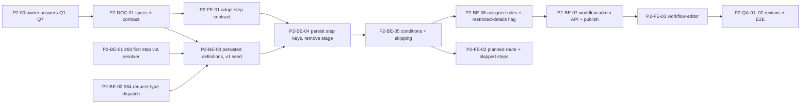

# Phase 2 Backlog — FlowOps

**Purpose:** the ordered backlog for Phase 2a, configurable routing of the existing request types (ADR-0014). Same rules as `PHASE1_TASKS.md`:
- each task is one focused session
- pick the lowest-numbered task in your lane whose dependencies are **Done**
- run `implement-feature` with its ID
- update its status here in the same PR

ADR-0014 is *Accepted* (owner answers in #98). The specs in **P2-DOC-01** are the source of truth for field names and endpoints. This file only sketches them, and implementation tasks wait for P2-DOC-01.

Status values: `Todo` · `In progress` · `Done` · `Blocked (reason)`. Every task inherits the Definition of Done (`AGENTS.md` §8).

---

## Lanes and order

**Parallel lanes:**
- **Now:** P2-BE-01 and P2-BE-02 are Phase 1 debt, so they can start before P2-00.
- **Once P2-DOC-01 has published the contract:** the frontend works against MSW mocks generated from `contracts/openapi.json`, as in Phase 1. `step` and `route` are already served next to the deprecated `stage` (additive first, AGENT_HANDOFF §3.4), so **P2-FE-01 can start right away**, and P2-BE-04 removes `stage` once P2-FE-01 has merged.

---

## Design sign-off

### P2-00 — Owner answers ADR-0014 §5 (Q1–Q7, #98) · `Done` (2026-11-11)
All recommended defaults were accepted except Q1: **one administrator edits and publishes workflows, with no second-admin approval**. Recorded in ADR-0014 (Accepted, supersedes ADR-0004).

### P2-DOC-01 — Phase 2a specs and contract · `Done` (2026-11-11)
- **Objective:** write the agreed design into the existing docs:
  - DOMAIN_MODEL: entities, I7 rewording, facts catalogue
  - WORKFLOWS: skip semantics, publish flow
  - AUTHORIZATION: `workflows.manage` capability (Administrator), single-admin publish, audit log, restricted-details flag
  - API_CONTRACT and `openapi.json`: workflow endpoints, `step` replacing `stage`, `StepSkipped`, planned route
  - UI_SPEC: editor, route display
  - TESTING: new required tests
- **Deps:** P2-00.
- **AC:** every endpoint and field the tasks below use is in the contract. Contract skeleton endpoints return 501 until implemented, as BE-03 did.
- **As built:**
  - Specs: DOMAIN_MODEL §7, WORKFLOWS §6, AUTHORIZATION §8, API_CONTRACT §10 (plus `step`/`route` in §4–8), UI_SPEC §7, TESTING §3.7.
  - Served now (additive): `step: StepRef` next to the deprecated `stage` on every DTO that had it; `route` on request details (from `FixedProcesses` until P2-BE-05); the `StepSkipped` activity type (migration `AddStepSkippedActivity` widens the check constraint); the `workflows.manage` capability for Administrators.
  - Stubs (501, final route and policy): `POST /api/requests/route-preview` (P2-BE-05) and the ten `/api/admin/workflows/*` endpoints (P2-BE-07).
  - Error codes `workflow.draft_exists`, `workflow.version_not_draft` and `workflow.invalid`, with their frontend messages.

---

## Backend

### P2-BE-01 — First step through the resolver (#83) · `Done` (2026-11-11)
- **Objective:** `Request.Start` takes `Func<ProcessStep, Assignee>` and reuses `ResolveNextAssignee`. Submission notifies via `TaskEligibility.EligibleDeciders`, like decisions. Fix as proposed in #83.
- **Deps:** none (Phase 1 debt).
- **Tests:** a first step that is a role queue works with no change outside its process entry. The I12 pre-check is kept.

### P2-BE-02 — Request-type dispatch in one home (#84) · `Done` (2026-11-11)
- **Objective:** route all four places that branch on request type through one place each:
  - `RequestTitle.For(…)` with an exhaustive `throw`
  - `TypeLabel` as a `switch` on `RequestType` with a throwing default
  - generic "approved" notification text, with no hardcoded "Procurement is next"
- **Deps:** none (Phase 1 debt).
- **Tests:** each switch is exhaustive. Notification text matches WORKFLOWS §1.4.

### P2-BE-03 — Persisted workflow definitions; seed v1 · `Todo`
- **Objective:**
  - add `WorkflowDefinition` / `WorkflowVersion` / `WorkflowStep`, with EF configuration and a migration
  - add `IProcessDefinitionSource`
  - seed purchase and leave as Published v1, identical to `FixedProcesses`
  - add `Request.WorkflowVersionId`, backfilled for existing rows
  - delete `FixedProcesses`
- **Deps:** P2-DOC-01, P2-BE-01, P2-BE-02.
- **AC:** **no behaviour change**. All Phase 1 integration and E2E tests pass unchanged. Published versions are immutable (domain-enforced). Exactly one Published version per request type (partial unique index).
- **Tests:** seed equivalence with the old fixed steps; immutability; one-published index; the backfill migration on a database with requests in every state.

### P2-BE-04 — Persist step keys; remove `stage` · `Todo`
- **Objective:**
  - store the step key plus a name snapshot on requests, tasks and activities in place of the `RequestStage` enum (DOMAIN_MODEL §7.4); `step` is then read from storage, not from `StepRef.For`
  - `Closed` becomes request-status logic only
  - migrate existing enum values to the seeded v1 keys
  - remove the deprecated `stage` fields and `RequestStage` from the contract (P2-DOC-01 already serves `step`); regenerate `openapi.json`
- **Deps:** P2-BE-03, P2-FE-01 (the frontend no longer reads `stage`).
- **AC:** one coordinated contract change (AGENT_HANDOFF §3). The OpenAPI drift check is green. The PR lists every renamed field for the frontend lane.
- **Tests:** contract tests; the migration keeps the history readable.

### P2-BE-05 — Conditions, skipping and the planned route · `Todo`
- **Objective:**
  - facts catalogue per request type (purchase: `amount`; leave: `leaveType`, `days`)
  - typed operators
  - `Condition.IsMetBy(facts)`
  - the next step is the first later step whose condition holds
  - a `StepSkipped` activity for each skipped step
  - request details expose the remaining planned route
- **Deps:** P2-BE-04.
- **AC:** the owner's rule works: Manager → Finance if amount > 1000 JOD, else → Procurement.
- **Tests:**
  - domain: every operator on both sides of the boundary (1000.000 vs 1000.001)
  - domain: all skipped, so the request completes
  - domain: the first step can't have a condition
  - integration: the full route for 400 and 1,500 JOD, with I5, I11 and T3 unchanged

### P2-BE-06 — New assignee rules and the restricted-details flag · `Todo`
- **Objective:**
  - add `DepartmentRole`, `SpecificUser` and `ManagerOfManager` in `AssigneeRule` and `TaskAssigneeResolver`
  - extend stalled-task detection to them
  - add a per-step `canReadRestrictedDetails` flag replacing the hardcoded HR rule in `AccessRules` (ADR-0014 Q3)
- **Deps:** P2-BE-05.
- **Tests:**
  - each rule resolves, including inactive and missing targets → stalled
  - Administrator is never assignable
  - leave-reason visibility matrix rerun with the flag: same results as Phase 1 for the seeded v1

### P2-BE-07 — Workflow administration API · `Todo`
- **Objective:**
  - list workflows and versions
  - create and edit a Draft (copy of the Published version)
  - validate a draft:
    - errors: first step conditional, unknown fact, operator not valid for the fact's type, duplicate key, Administrator assignee
    - warnings: an assignee with no current holder
  - preview a route for sample facts
  - publish by a single administrator (Q1): retires the previous Published version, records `PublishedBy`/`PublishedAt`, and is audit-logged
- **Deps:** P2-BE-06.
- **AC:** authorization per AUTHORIZATION (Phase 2 section). Drafts use optimistic concurrency (409 on stale version). Publishing never changes in-flight requests.
- **Tests:** permission matrix, where non-admins get 403 and admins without the capability are covered; every validation error; publish retires the old version and writes the audit log; in-flight requests keep their pinned version.

---

## Frontend

### P2-FE-01 — Adopt the `step` contract · `Done` (2026-11-11)
- **Objective:** replace stage labels and mappings (`lib/format/status.ts`, `features/tasks/decisions.ts`, the mocks) with the server-provided `step.name`, per UI_SPEC §7.1. The types are already generated (P2-DOC-01).
- **Deps:** P2-DOC-01.
- **AC:** no hardcoded step names remain in the frontend.

### P2-FE-02 — Planned route and skipped steps · `Done against mocks` (2026-11-11; real-API verification waits for P2-BE-05)
- **Objective:** request details show the planned route as a step list with the current step highlighted. The timeline renders `StepSkipped` with its reason. The new-request flow shows the route before submit, if the contract provides a preview.
- **Deps:** P2-BE-05.
- **Tests:** route for both branches; skipped entry text; accessible labels.

### P2-FE-03 — Workflow editor · `Todo`
- **Objective:** admin screens for workflows:
  - list, plus a version history
  - step-list editor: reorder; name, kind and "who approves" picker; an optional "Only if" row of field / operator / value dropdowns; the restricted-details toggle with a warning
  - validation errors and warnings from the server
  - preview with sample values
  - a publish confirmation dialog that says new requests will use this version and in-flight ones keep theirs
- **Deps:** P2-BE-07.
- **AC:** built only from `components/ui` and `layout`, with theme tokens only. Permissions come from server capabilities. WCAG AA, including keyboard reordering.
- **Tests:** editing and reordering; server-error display; publish confirmation and success; 409 on a stale draft.

---

## Quality

### P2-QA-01 — Security and architecture review of Phase 2a · `Todo`
`security-reviewer` and `architecture-reviewer` over workflow admin, single-admin publish and its audit log, conditions, assignee rules and restricted-details access. **Deps:** P2-BE-07, P2-FE-03.

### P2-QA-02 — E2E: configurable routing · `Todo`
Playwright: an admin adds "Finance only if amount > 1000" and publishes it; one purchase of 400 JOD (skips Finance) and one of 1,500 JOD (goes through Finance). In-flight requests keep their old route. **Deps:** P2-FE-03.

---

## Later (not in Phase 2a)
- **Two-person publish** (declined in Q1; can be added later with the ADR-0012 pattern).
- **Phase 2b form builder** (ADR-0014 Q4): admin-defined request types and fields (`FormSubmission` jsonb), with form fields usable as facts.
- **Reassignment and delegation** (Q7): its own ADR.
- **Email notifications**, for example via Gmail (MailKit + OAuth): needs ADR-0010 revisited for reliable sending.
